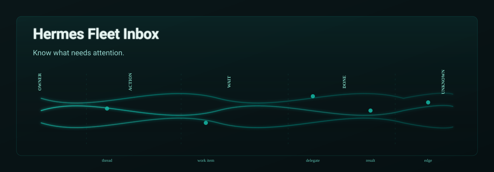
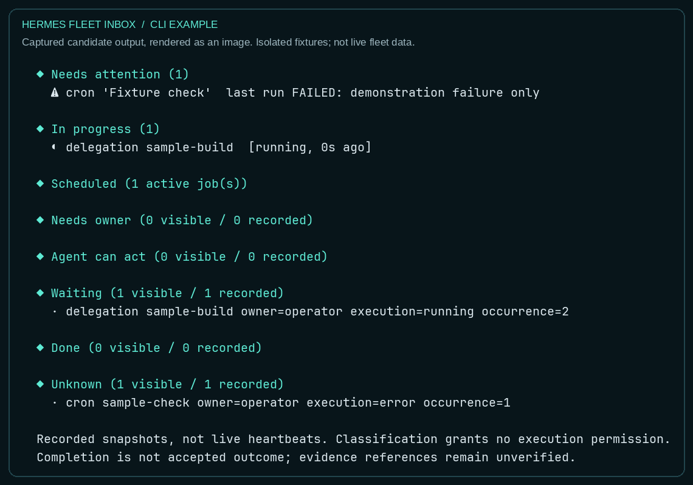

# Hermes Fleet Inbox

A fleet-aware work-and-attention inbox for Hermes agents, derived from Nous Research's Inbox plugin. Herald integration enables same-host profile-ledger aggregation, exact-ID work threads, and explicit local observation coverage.



## Core capabilities

The original read-only snapshot covers background work, native async delegations, scheduled jobs, open sessions and the shared Kanban board.

Herald integration adds `--fleet` for same-host native profile-ledger discovery, exact-ID work threads, scoped configuration and explicit coverage/truncation metadata. It excludes full prompts and result previews. This does not establish remote-host coverage, accepted task outcomes or user delivery.

```text
hermes inbox                 active-profile snapshot
hermes inbox --json          machine-readable snapshot
hermes inbox --fleet --json  candidate Herald view; requires this fork installed
```



The example is captured candidate output rendered as an image, not a mock web UI
or a screenshot of private fleet activity.

## Explicit local observations

```text
hermes inbox observe --fleet            ingest a bounded snapshot explicitly
hermes inbox changes --consumer owner --json
hermes inbox mark-seen --consumer owner --through <observed-sequence>
hermes inbox ack <observed-sequence>     acknowledge this occurrence locally
hermes inbox snooze <observed-sequence> --seconds 60
```

Only explicit observation, cursor and attention actions write the plugin-owned `<profile-home>/inbox/state.db`. Repeated identical observations do not create duplicate events; consumer cursors are independent. Native source stores are not updated.

## Attention, without invented certainty

Five lanes separate **Needs owner**, **Agent can act**, **Waiting**, **Done** and
**Unknown**. They preserve source identity, responsibility where known, execution,
accepted outcome, delivery, references and local observation sequence numbers.
Completed execution alone is not an accepted outcome. Missing approval, action or
acceptance facts stay unknown; the lanes do not manufacture those facts.

Acknowledgment applies to one observed occurrence, not the source task. A changed
failure reappears; snooze expiry reappears on the next view without a background
job. Consumer cursors are independent and never advance just by viewing changes.
References are explicitly unverified; a path or hash is not proof of acceptance.

## Before marketplace distribution

The [live-pilot checklist](docs/product/live-pilot.md) requires a frozen reviewed
artifact, native installation testing, a controlled live lifecycle on the default
profile, persistence/isolation/failure checks, normal-work observation, and then
sequential profile qualification. A green source suite is not fleet acceptance.
Catalog admission is a separate maintainer decision, never an automatic outcome.

## Safety boundary

- Native task, session, cron and dispatch stores are read-only sources.
- Inbox-owned state records observations, cursors and attention only. It cannot turn a native failure into success or close the source task.
- Execution, accepted outcome, evidence, result delivery and acknowledgment are different facts; one does not prove another.
- "Agent can act" is a classification, not execution permission.
- Automatic status refresh, existing-result retrieval and snooze-expiry hooks are plans only. They are not activated by installing this development candidate.
- No task reruns, model/provider changes, service restarts, external sends or autonomous repairs are enabled by this repository.
- Private ledgers, runtime databases, prompts, coordination plans and credentials are not repository content.

## Development and installation status

The plugin retains the nested `inbox/` layout. Compatibility tests run against Hermes core and seed isolated temporary data. A release will include the exact repository/subdirectory and immutable commit to install; there is no accepted release pin yet. Do not manually overwrite a running plugin or edit profile configuration to infer that this candidate is installed.

Use a reviewed immutable commit with the native installer:

```text
hermes plugins install RohiRIK/hermes-inbox/inbox --ref <40-character-commit> --enable
```

This shares the upstream `inbox` plugin ID: replace it deliberately with a backup,
not side by side. `hermes plugins install inbox` selects the upstream catalog
entry, not this fork. See the [plugin reference](inbox/README.md) for bounds and
configuration. Nothing automatically polls, retries tasks or contacts agents.

Catalog eligibility is a separate maintainer-controlled process. This fork does not replace the upstream catalog listing and is not an officially supported Nous Research product.

## Origin and license

Derived from the Inbox plugin in
[NousResearch/hermes-labs-plugins](https://github.com/NousResearch/hermes-labs-plugins).
Upstream copyright notices and the MIT license are retained.

Powered by caffeine and questionable life choices.